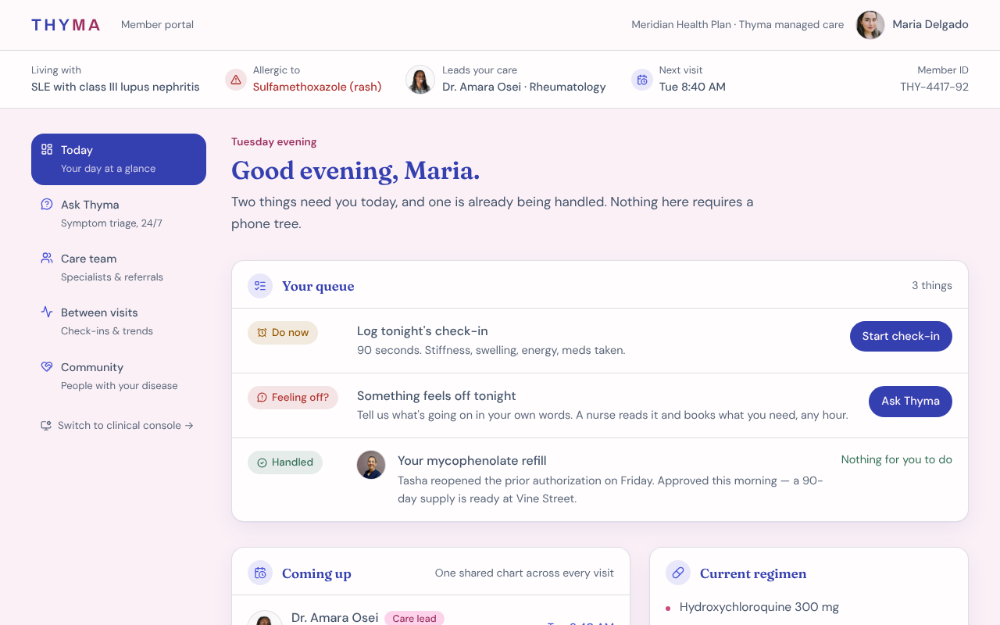
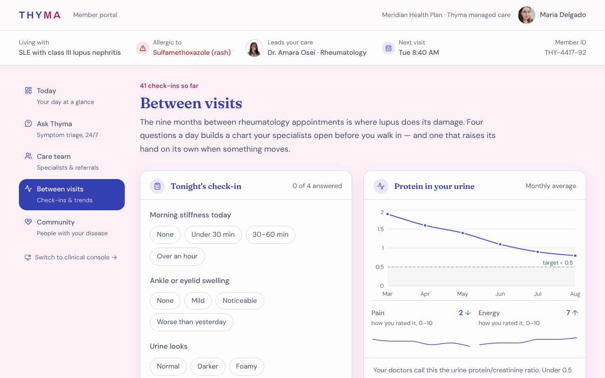
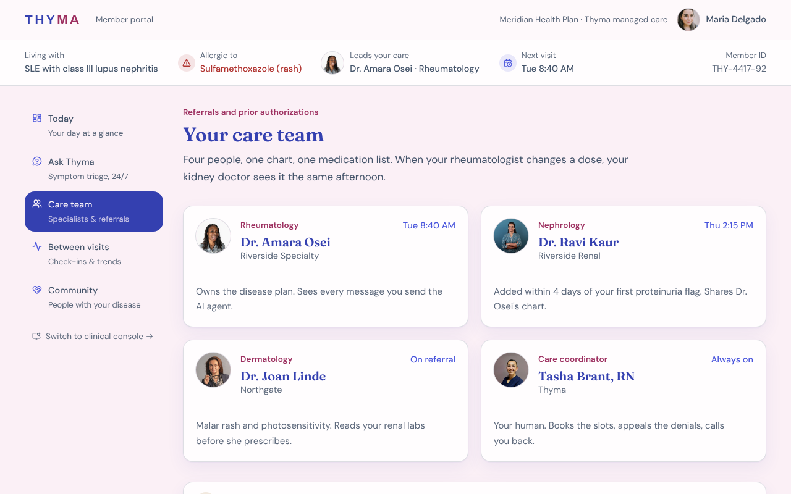
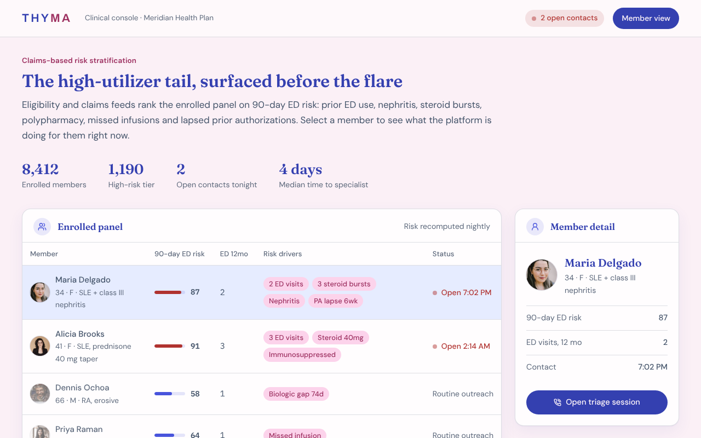
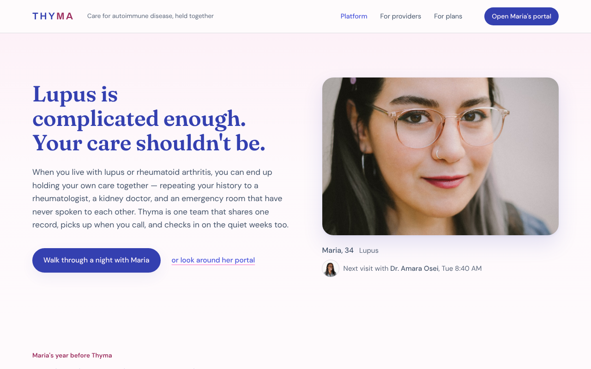
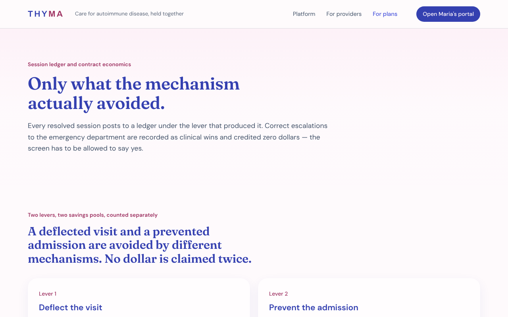

# Thyma: coordinated care for lupus and rheumatoid arthritis

Thyma is a front-end prototype of a managed-care platform for people with autoimmune disease. It shows one connected experience for three audiences: the patient, the clinical care team, and the health plan paying for care.

> **All people, diagnoses, labs, claims and transcripts in this repo are fictional.** Portraits are Unsplash stock photos used as stand-ins (see [`public/people/CREDITS.md`](public/people/CREDITS.md)). No real patient data is stored, and the app has no backend or authentication.

## The problem

Autoimmune patients typically see several specialists who do not share a record. Flares happen at night with nobody to call, prior authorizations stall, and the result is long waits, avoidable emergency visits and cost. Thyma sketches what the alternative could look like: specialists on one shared chart, a nurse who answers any hour, and short check-ins between visits so problems surface early.

## What is in the prototype

| Route | Audience | What it shows |
| --- | --- | --- |
| `/` | Everyone | Landing page and the before/after story of fragmented care |
| `/app` | Patient | "Today" view: queue, upcoming visits, current regimen |
| `/app/chat` | Patient | Symptom triage chat, 24/7 |
| `/app/care` | Patient | Care team and referrals |
| `/app/tracking` | Patient | Between-visit check-ins and trend charts |
| `/app/community` | Patient | Peer community for people with the same disease |
| `/console` | Care team | Panel ranked on 90-day ED risk, open contacts routed to triage |
| `/providers` | Referring clinicians | Referral intake |
| `/payers` | Health plans | Contract model |

## Screenshots

| Patient home | Between visits |
| --- | --- |
|  |  |

| Care plan | Clinical console |
| --- | --- |
|  |  |

| Landing page | Payer view |
| --- | --- |
|  |  |

## Tech stack

- [TanStack Start](https://tanstack.com/start) with file-based routing (TanStack Router) and SSR
- React 19 and TypeScript
- Tailwind CSS v4, Radix UI primitives and shadcn/ui-style components
- Recharts for trend charts
- Vite 8, deployable to Cloudflare Workers via Nitro
- ESLint and Prettier; GitHub Actions for CI
- Scaffolded with [Lovable](https://lovable.dev)

## Run it locally

Requires Node.js 20 or newer. [Bun](https://bun.sh) is the lockfile format of record, but npm works too.

```bash
bun install        # or: npm install
bun run dev        # or: npm run dev
```

Then open the URL Vite prints (usually http://localhost:5173).

Other scripts:

```bash
npm run lint       # ESLint
npm run build      # production build into .output/
npm run preview    # serve the production build
npm run format     # Prettier
```

## Project structure

```
src/
  routes/            File-based routes (see src/routes/README.md)
    app/             Patient portal (today, chat, care, tracking, community)
    console.tsx      Care team console
    providers.tsx    Referral intake
    payers.tsx       Health plan view
  components/
    thyma/           App-specific components (shell, panels, portraits)
    ui/              Shared UI primitives (shadcn/ui style)
  data/              Fictional demo data (patients, people, claims, labs)
  lib/               Utilities and error handling
  styles.css         Design tokens and Tailwind setup
public/people/       Stock portraits and credits
docs/screenshots/    Images used in this README
```

## Notes

- Data lives in `src/data/` and is static; there is no API.
- `src/routeTree.gen.ts` is generated by TanStack Router. Do not edit it by hand.
